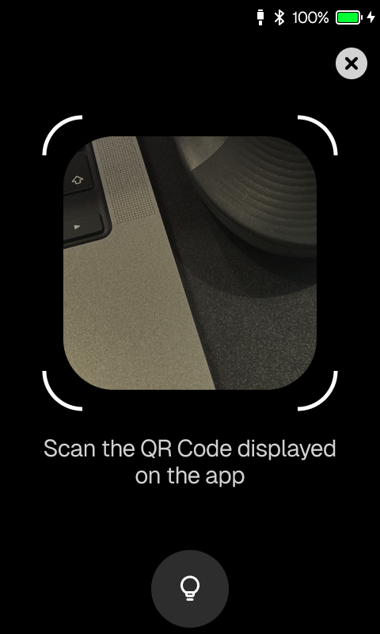
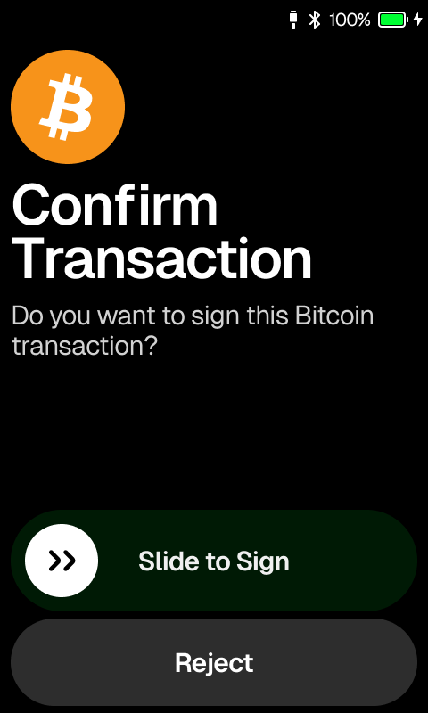

# Tutorial: Wallet Integration

An air-gap integration exchanges account information, signing requests, and signatures through QR codes. Your application builds transactions and communicates with the network; the hardware device reviews and signs the request.

## Install the SDK

```bash
npm install @onekeyfe/hd-air-gap-sdk
```

The examples use `Buffer`; browser projects need a compatible Buffer implementation. Camera access, QR rendering, transaction construction, and broadcasting belong to your application.

## Add a hardware account

Export the account QR code from the device and scan it in your wallet:

<table data-view="cards"><thead><tr><th></th></tr></thead><tbody><tr><td></td></tr><tr><td></td></tr><tr><td></td></tr></tbody></table>

Decode the `crypto-hdkey` registry object to obtain its extended public key, origin path, master fingerprint, and optional children path. Use the [CryptoHDKey decoder example](api-reference/basic-api/cryptohdkey.md).

Public derivation is appropriate only for non-hardened children supported by the exported key. Preserve the actual account layout instead of assuming that every export uses `0/*`. Your address library should derive the chosen child key and format the address for the target chain.

## Scan QR codes

Animated QR transfers contain multiple fragments. Feed each camera result to one decoder until it succeeds. Start a new decoder for the next account or signature transfer.

```typescript
import { URDecoder } from '@onekeyfe/hd-air-gap-sdk';

const decoder = new URDecoder();
function onQrFrame(frame: string) {
  if (!frame || decoder.isComplete()) return;
  decoder.receivePart(frame);
  if (decoder.isError()) throw new Error('Could not decode the QR transfer');
  if (!decoder.isSuccess()) return;
  const ur = decoder.resultUR();
  // Check ur.type before passing ur.cbor to a registry decoder.
  return ur;
}
```

## Request a signature

1. Build the unsigned transaction using the network's current nonce, fee, and chain information.
2. Encode the unsigned signing bytes using [EthSignRequest](api-reference/ethereum-and-evm/ethsignrequest.md). Select the data type for a legacy transaction, EIP-1559 transaction, EIP-712 object, or personal message.
3. Include the account's actual derivation path and master fingerprint, and retain a fresh request UUID with the original unsigned payload.
4. Display the UR encoder's fragments as animated QR codes. Stop the animation on completion or cancellation.

## Confirm on the hardware device

The user scans the request and reviews the details on the device. After confirmation, the device displays the signature QR code.

<table data-view="cards"><thead><tr><th></th></tr></thead><tbody><tr><td></td></tr><tr><td></td></tr><tr><td></td></tr><tr><td></td></tr></tbody></table>

## Decode and use the signature

Scan the signature into a new decoder and follow [ETHSignature](api-reference/ethereum-and-evm/ethsignature.md). Check the UR type, signature length, and request ID, then verify that the signature corresponds to the intended signer and original payload.

For a transaction, use your Ethereum library to attach the signature to the **same transaction type and fields** that were sent for signing. A legacy transaction serializer cannot be substituted for an EIP-1559 serializer. Once validation succeeds, your application can broadcast the signed transaction.

For a personal message or typed-data signature, return it to the requesting application rather than broadcasting it as a transaction.
